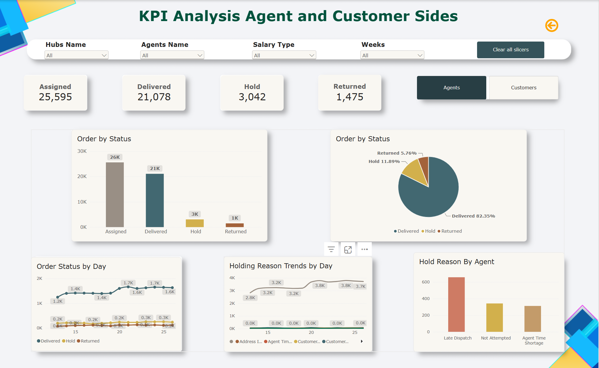

# Logistics KPI Analysis & Performance Optimizations

## Dashboard

[View the dashboard](https://public.tableau.com/app/profile/naimur.rahman5472/viz/order_analysis_dashboard/order_analysis?publish=yes)

## Analysis Topic

| Topic |
| --- |
| Daily agent productivity and average deliveries per agent per day |
| Hub utilization in Week 1 and Week 2 | 
| Hold reasons and the main operational causes |
| Final outcomes of orders held at least once |
| Agents required to meet forecast demand and staffing gaps |

## Hub-by-Hub Performance

| Hub | Agents | Util W2 |
|---|---:|---:|
| Greenfield | 10 | 87.03.6% |
| Hillcrest | 9 | 82.54% |
| Westwood | 9| 83.06% |
| Riverside | 12 | 72.43% | 
| Brookside | 11 | 63.95% |
| Lakeview | 11 | 57.62% |

## Problem Identification

### 1. Capacity Mismatch

Lakeview has 3 surplus agents at **56% utilisation**, while Hillcrest operates at **96% utilisation**.

- **57%** — Lakeview
- **87%** — Hillcrest

The underlying problem is **uneven agent distribution across hubs**, resulting in underutilised capacity in some hubs and excessive workload in others.

### 2. Operational Waste at Riverside

Riverside recorded **874 holds in Week 2**, more than all other hubs combined. Approximately **64% were agent-side holds**, indicating operational inefficiencies such as late dispatch and orders not being attempted.

- **1.351** — Riverside attempts per order
- **1.121** — Company average

Riverside's higher attempts per order indicate additional operational effort and potential delivery inefficiencies.

## Recommendations

### Step 1: Optimize Agent Distribution

Transfer **3 agents from Lakeview** to hubs with higher capacity requirements.

### Step 2: Hire 2 Fixed Agents

Hire **2 additional fixed agents** to address the remaining workforce gaps.

### Step 3: Improve Riverside Dispatch Operations

Address late dispatch and agent-side holds to reduce unnecessary delivery attempts and improve operational efficiency.

## Forecasted Outcome

| Hub | Current Agents | After Distribution |
|---|---:|---:|
| Greenfield | 10 | 12 |
| Hillcrest | 9 | 11 |
| Riverside | 12 | 13 | 
| Westwood | 9 | 9 | 
| Brookside | 11 | 11 | 
| Lakeview | 11 | 8 |